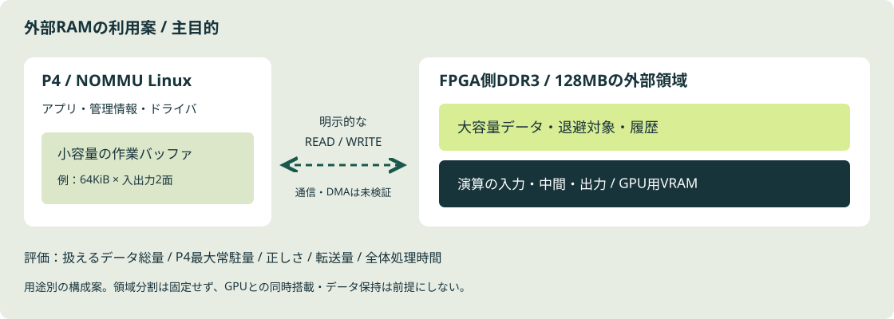
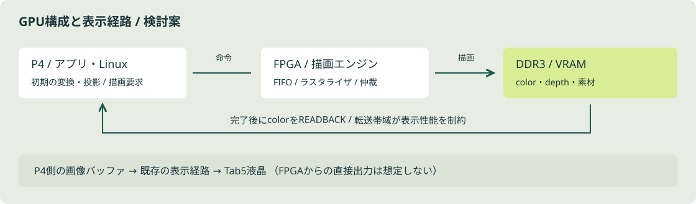
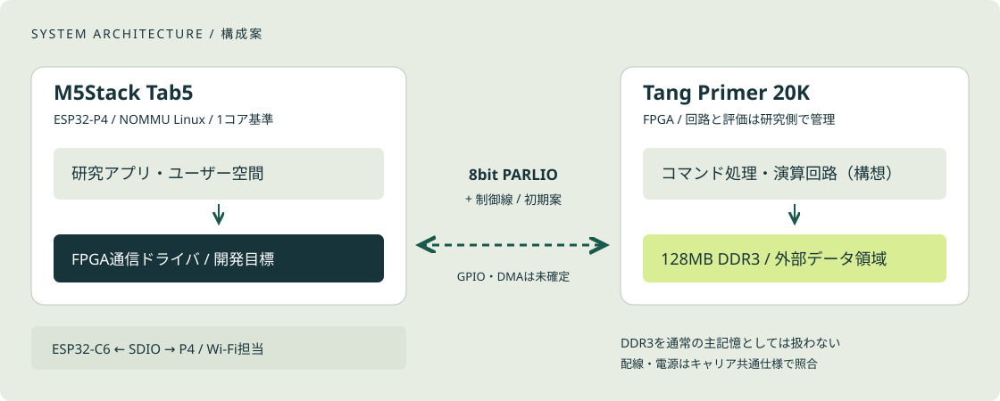

# Tab5 Linux × FPGA — プロジェクトガイド

更新日：2026-10-28

主目的は、Tang Primer 20Kの128MB DDR3をTab5 NOMMU Linuxから利用し、P4単体のメモリ制約で扱いにくいデータ処理を可能にすることです。用途別のメモリ管理と演算オフロードを研究し、応用としてFPGAによるGPU構成も検討します。Linuxと通信ドライバは、そのための基盤として開発します。

## 目的

### 主目的：FPGA側RAMの活用

大容量データの分割処理、退避・復元、一時保存、演算用バッファを対象に、P4側の常駐メモリを抑えながら扱えるデータ量を増やします。各用途の成立条件と効果を実測します。

### 応用：演算とGPU構成

DDR3にデータを保持したままFPGAで処理し、ホストとの転送量を抑える構成を検討します。GPUではフレームバッファ、深度、テクスチャなどへの利用を検討します。

### 基盤：Linuxと通信

LinuxのAPIと開発資産を利用し、明示的な外部メモリAPIと通信ドライバを開発します。1コア起動を基準に検証し、RAM活用の評価へ接続します。

## 主目的：FPGA側RAMの用途と評価計画

### 目標と成立条件

RAM活用を本プロジェクトの主目的とします。Linuxの起動やドライバ開発は、外部データ領域を利用するための前提作業です。成功は、外部RAMの全域を照合できることに加え、P4側の小さい作業領域で、より大きいデータを正しく処理できることと定義します。

以下は用途案であり、外部RAM API・DDR3接続・演算回路の実装や性能は未検証です。128MBは基板側容量の呼称で、アプリへ公開できる実容量はDDR3初期化と予約領域を確認して確定します。数値例では1KiB=1,024 bytes、1MiB=1,048,576 bytesを用います。

### 用途別の設計案

| 用途・優先度 | DDR3に置くもの / 利用方法 | 成立条件・評価項目 |
| --- | --- | --- |
| 大容量データの分割処理 / 最優先 | 配列、画像集合、計測データなどを外部オブジェクトとして保存。P4へ処理対象のブロックだけ読み、結果を書き戻す。 | 連続アクセスとランダムアクセスを比較。データ量、P4最大常駐量、転送量、全体処理時間、結果一致を測定。 |
| 明示的な退避・復元 / 優先 | 再利用まで時間のあるアプリ所有バッファや中間結果を外部へ退避。必要になった時点でP4の作業バッファへ復元。 | アプリが退避可能なデータを指定する。復元後の一致、待ち時間、P4側で解放できた実容量、管理情報の負担を測定。 |
| 揮発性の一時ブロック領域 / 後続 | 実験用ブロックデバイスを介した一時ファイルや作業データ。まず生ブロック読み書きと整合性を検証し、必要ならファイルシステム接続を検討。 | tmpfsの置き場所が自動でDDR3になるわけではない。ドライバ・キャッシュのP4 RAM消費、ファイルI/Oの時間、異常終了・再初期化時の扱いを確認。 |
| ストリーム用リングバッファ / 後続 | 計測値、音声、画像の履歴を循環保存し、過去の区間を分割して取得する。入力機器の対応は別途必要。 | 入力レートに書込み帯域が追従すること。バッファ満杯時の上書き・停止方針、欠落数、連番、読み出し遅延を測定。 |
| 演算オフロード用バッファ / 後続 | 画像フィルタ、FFT、行列演算の入力・中間・出力をDDR3に保持。演算をデータの近くで実行し、必要な結果だけP4へ返す。 | 演算候補は資源・数値精度・転送量で選ぶ。転送込み処理時間、CPU負荷、誤差、FPGA資源と消費電力を比較。 |
| GPU用VRAM / 応用研究 | color/depth、テクスチャ、スプライト、頂点・描画リストなどを保持。FPGAが描画し、P4へ結果を読み戻す構成を検討。 | DDR3内の描画帯域とP4への読出し帯域を別々に評価。解像度、バッファ数、描画機能、転送を含むフレーム時間を固定する。 |

### 分割処理の具体例

設計例として64MiBのデータを64KiB単位で処理します。P4側に入力・出力各64KiBの作業バッファを用意する場合、ペイロード用領域は合計128KiBで、処理単位は1,024ブロックです。OS、ドライバ、アプリ本体、メタデータ、追加コピーのRAMは別に必要です。64MiBを一括mallocする方式ではありません。

ALLOCで外部領域を確保し、WRITEで入力を保存、READで必要なブロックを取得、P4で処理、WRITEで出力を保存し、最後にFREEで解放する流れを想定します。演算オフロード時は、FPGAがDDR3内で処理し結果を返します。ここでのAPI名は説明用で、ABI・命令番号・同期方式は未確定です。

画像フィルタで隣接画素が必要な場合は、ブロック端に重なり領域を設けます。分割FFTや行列演算ではアルゴリズムごとの再読込み・中間領域も計上します。分割できるだけで高速化するとは扱いません。

### アプリとドライバの管理方針

- 外部オブジェクトはハンドル・世代番号・長さで管理し、読み書き範囲、アラインメント、解放後アクセスを検査する案とする。外部アドレスを通常のCPUポインタとして公開しない。
- P4側キャッシュを設ける場合は、小さなローカル作業領域と明示的な取得・書戻しで管理する。更新済みブロック、再利用、追出しの条件を定義する。CPUの通常のページフォルトによる自動ページングではない。
- 転送・演算中のバッファ所有権を定義し、CPUとFPGAの同時更新を防ぐ。完了通知、タイムアウト、CRC、部分転送、再送の扱いを決める。タイムアウトだけでバッファを再利用せず、停止・取消し完了または再初期化を確認する。
- FPGA再構成、DDR3再初期化、電源断でデータが保持されると仮定しない。セッション識別子などで古いハンドルを無効化する。永続保存が必要なデータは別の不揮発媒体へ退避する。

### 用途の採否を決める測定

| 観点 | 測定・比較方法 |
| --- | --- |
| 正しさ | 全域・境界・異なるパターン・繰返し・ランダムアクセスで照合し、範囲外要求と異常時の状態を確認。 |
| メモリ効果 | データ総量とP4側の最大常駐量を別々に記録。バッファ以外のドライバ・管理表・コピー・キャッシュも計上。 |
| 転送と局所性 | READ/WRITE別、ブロックサイズ別、連続/ランダム別に実効帯域、平均・p95遅延、CPU負荷を測定。 |
| 処理全体 | 同じ入力・同じ数値規則のP4基準と比較。総時間は投入・待機・演算・結果回収・管理処理を含む。 |
| 容量拡張と高速化 | P4単体では収まらないデータを処理できた効果と、同じサイズの処理が速くなった効果を別に判定する。転送で遅くなる用途も結果として記録。 |

### RAM活用の検証順序

- R0：DDR3初期化と実容量の確認、全域分割READ/WRITE、CRC・範囲外・異常時の検証。L2〜L4の基盤と対応する。
- R1：64MiB / 64KiBなど条件を固定した分割処理を実装し、小さいP4作業領域で正しく処理できることを確認。データ量とブロックサイズは測定条件として変更可能にする。
- R2：明示的な退避・復元を実装し、P4側の実際のRAM節約量と復元コストを確認。ランダムアクセスの限界も測る。
- R3：一つの演算を選び、DDR3にデータを保持する利点を転送込みで評価。一時ブロック領域とリングバッファは用途の必要性に応じて追加。
- GPU構成は別系統で設計・参照実装を検討し、通信とDDR3が成立した後に描画回路の実機評価へ進む。R0〜R3は本資料のRAM研究上の区分で、実装済み機能を示さない。

## 応用研究：FPGAによるGPU構成

### RAM活用からGPU構成への接続

FPGA側DDR3をVRAMとして使うGPU構成を応用研究に含めます。GPUの描画仕様・回路・参照実装は関連リポジトリtab5-fpga-gpuで管理し、本リポジトリではLinuxドライバとアプリからの利用経路を検討します。関連研究の設計案を参照しますが、Linux側で同じAPIや機能が利用できる状態ではありません。

初期段階は外部RAM用とGPU用のビットストリームを分けます。通信・バッファ管理・DDR3アクセスの契約を整合させ、同時搭載はLUT・DSP・BRAM・DDR3帯域・タイミングと調停の評価後に判断します。GPU構成の検討自体は目的に含め、初期の同時動作を完了条件にはしません。

### 検討するデータ経路と分担

- P4：アプリの状態管理、初期段階の頂点変換・投影・クリップ、描画命令の送信、完了待ち、表示用画像の読戻しを担当。
- FPGA：コマンドFIFO、範囲検査、描画エンジン、DDR3コントローラと仲裁、完了通知を構成要素として検討。BRAMは小さいFIFOやライン・タイルキャッシュに使い、大容量の画像・深度・素材はDDR3に置く。
- 初期の表示経路は、FPGAで描画 → DDR3 colorバッファ → P4へREADBACK → Tab5の既存表示経路を想定。FPGAからTab5のMIPI-DSI液晶へ直接出力する構成は前提にしない。
- Linuxユーザー空間からバッファ登録・描画要求・完了待ち・読戻しを扱う専用APIを検討する。OpenGL/Vulkan互換やLinuxデスクトップの自動高速化を、この構成だけで実現したとは扱わない。

### 段階別に検討する描画機能

| 段階 | FPGA側の機能案 | 主な検証 |
| --- | --- | --- |
| G0 / 最小ラスタライザ | CLEAR、画面座標の線・単色三角形、16bit深度。幾何処理はP4。 | 同一整数規則のCPU参照とcolor/depthを照合し、退化三角形、共有辺、画面端、深度を検証。 |
| G1 / 2D合成 | 画像アップロード、スプライト、scissor、色キー、整数alpha合成。 | 素材をDDR3へ一度保存して再利用し、命令量と画素読戻し量、透過・合成結果を測定。 |
| G2 / 幾何処理 | 頂点行列変換、クリップ、投影。 | 数値精度と境界条件を規定してCPU負荷、資源量、総フレーム時間を比較。 |
| G3 / テクスチャ描画 | UV補間、テクスチャ参照、透視補正、合成。 | 画像一致・許容誤差、DDR3アクセス局所性、キャッシュ効果、帯域とタイミングを評価。 |

### VRAM容量と表示転送の数値例

以下は容量・転送量の算術例で、実測性能や実現可能なFPSを示しません。RGB565と16bit depthを各2 bytes/画素、strideに余白なしと仮定します。フレームレート30は比較用の仮定です。

640×360の場合、color 1面は460,800 bytes。color 2面とdepth 1面は合計1,382,400 bytesです。全colorを毎秒30回P4へ読み戻すと、ペイロードだけで13,824,000 bytes/s（13.824MB/s）が必要です。

Tab5の720×1280相当ではcolor 1面が1,843,200 bytes。color 2面とdepth 1面は5,529,600 bytes。毎秒30回の全color読戻しには55,296,000 bytes/s（55.296MB/s）が必要です。命令、CRC、待ち時間、方向切替、コピー、LCDへの出力時間はこの値に含みません。

DDR3にフレームが収まっても、P4へ戻す回線が必要帯域に達するとは限りません。実測に応じて解像度低減、更新矩形・タイルの読戻し、素材の再利用、フレーム間隔の調整を評価します。DDR3内部でもcolor/depthの読書きと素材参照が競合するため、容量と帯域を別に予算化します。

### GPU構成の採否条件

- 同じ解像度・入力・描画順・数値規則でCPU参照と比較し、画素と深度の正しさを先に検証する。関連研究のESP-IDF評価値をLinux上の基準値として流用しない。
- 幾何処理、命令投入、GPU処理、読戻し、LCD出力、アプリ全体の時間を分けて測定する。演算部分だけの高速化を表示FPSの改善と同一視しない。
- LUT・DSP・BRAM・タイミング、DDR3待機、命令量と読戻し量、P4側RAMとCPU負荷、平均・p95フレーム時間を記録する。クロックや同時レーン数は合成・測定前に確定値としない。
- FPGA側RAMの用途実証を優先し、GPUは最小構成から評価する。統合構成は、独立構成の正しさと帯域・資源に余裕が確認できた後の追加研究とする。

## 構成

図は設計構想であり、動作確認済みの配線図ではありません。

## 仕様と前提

| 項目 | 内容・状態 |
| --- | --- |
| OS / CPU | ESP32-P4 / RISC-V NOMMU Linux。上流イメージでLinux 6.18.35、online CPU 0（1コア）を実機確認。 |
| 検証機材 | Tab5：P4 revision v1.3、16MBフラッシュ。BSP判定でST7121液晶（タッチFW=1）。Keyboardは未接続。 |
| 無線 | ESP32-C6 / SDIO / ESP-Hosted-NG 1.0.6.0.1。更新完了とSoftAP・Dropbear起動ログを確認。外部クライアント接続とSSHログインは未確認。 |
| FPGA / 外部領域 | Tang Primer 20K、128MB DDR3を想定。FPGAデバイス（回路・ビットストリーム・ピン・コマンド仕様）と共通配線・電源はキャリアリポジトリで管理。研究評価は研究リポジトリ。 |
| 通信案 | 8bit PARLIO + 制御線。GPIO、IRQ、DMA、Linux側の利用可否は未確定。ピン番号・電気仕様は本ページでは固定しない。 |
| プロトコル案 | コマンド、アドレス、長さ、要求ID、ペイロード、CRC、READYまたは割り込みを検討。ABIやパケット形式は未確定。 |
| ユーザー空間との接続案 | /dev/経由のREAD / WRITEを目標とする。COPY / FILL、退避・復元、演算オフロードは段階的に研究する。 |
| メモリの制約 | P4からFPGA DDR3を直接ロード・ストアできる通常RAMとしては扱わない。透過的なページング、通常のスワップ、大容量mallocは実現済みではない。 |

## 開発進捗

### 上流Linuxの実機起動 — 確認済み

上流720cb8bの配布イメージを使用し、USBシリアルシェル、1コア、メモリ情報を確認。フォーク独自イメージの起動成功とは区別する。

根拠：[2026-10-22 実機検証記録](https://github.com/airpocket-soundman/tab5-linux-fpga/blob/main/docs/BRINGUP_2026-10-22.md)

### フォークの全体ビルド — 確認済み

mainの519c095でtab5-buildが成功。CIのビルド成功であり、この成果物の実機検証は未実施。

根拠：[フォーク全体ビルド成功（519c095）](https://github.com/airpocket-soundman/tab5-linux-fpga/actions/runs/39729147095)

### ST7121の単体表示 — 確認済み

ESP-IDF 5.5.5 / Tab5 BSP 1.3.2で表示テストをビルド・書き込み。ユーザーの目視で画面表示を確認。Linux上の表示ではない。

根拠：[2026-10-22 実機検証記録](https://github.com/airpocket-soundman/tab5-linux-fpga/blob/main/docs/BRINGUP_2026-10-22.md)

### LinuxのST7121対応 — 実験実装

codex/st7121-displayの6a2cf3dに初期化表とタイミングを追加。tab5-panel-build成功。カーネルとDTBの成果物であり、完全なフラッシュイメージではない。実機表示は未検証。

根拠：[ST7121カーネルビルド成功（6a2cf3d）](https://github.com/airpocket-soundman/tab5-linux-fpga/actions/runs/39743028254)

### L0の残りの項目 — 未検証

LinuxでのST7121表示、Keyboard、外部Wi-Fi接続、SSHログイン、再起動後の設定永続化を確認する必要がある。

根拠：[開発目的と引き継ぎ](https://github.com/airpocket-soundman/tab5-linux-fpga/blob/main/docs/DEVELOPMENT_GOALS.md)

### FPGA通信とDMA — 計画

GPIO競合、PARLIO、IRQ、DMA、キャッシュ整合性を調査する段階。転送帯域やCPU負荷の測定結果はまだない。

根拠：[開発目的と引き継ぎ](https://github.com/airpocket-soundman/tab5-linux-fpga/blob/main/docs/DEVELOPMENT_GOALS.md)

最後に記録した実機はP4が単体ESP-IDF表示テスト、C6がESP-Hosted-NG。Linuxには戻していません。USB付近の発熱原因・正常性は未判定です。

## 開発計画

日付による期限は未設定。カーネル更新・SMP・FPGAドライバ追加は段階的に行います。

| 段階 | 状態 | 作業 | 完了条件 |
| --- | --- | --- | --- |
| L0 | 進行中 | 1コア起動の基準を作る | ビルド環境・依存バージョン・イメージハッシュ・起動ログを保存し、シェル、対応液晶、Keyboard、Wi-Fi、SSH、メモリ情報を確認する。 |
| L1 | 未完了 | 上流修正を評価する | 修正の採否と依存関係を記録し、L0の機能を再確認する。SMP有効化は安定性の検証後に判断する。 |
| L2 | 未着手 | FPGAと最小通信する | キャリア仕様との照合、GPIO競合とPARLIO対応の確認を経て、低速コマンド送受信とデータ照合を実機で完了する。 |
| L3 | 未着手 | ドライバとDMAを実装する | /dev/からREAD / WRITEを実行し、タイムアウト、エラー通知、バッファ寿命、キャッシュ同期を検証する。 |
| L4 | 未着手 | 外部RAMの用途を実証する | 128MB全域の分割読み書き・照合後、小容量のP4側バッファで大容量データを処理し、退避・復元、演算オフロードの効果と制約をCPU基準と比較する。帯域、遅延、CPU負荷、P4常駐量を記録する。 |

## 次の作業

1. 単体表示テストを基準に、ST7121初期化表とタイミングをLinuxへ移植した成果物を実機で検証する。調査はユーザーの再開指示を受けて進める。
2. USB付近の発熱について、温度と発生条件を記録して原因を調べる。現在は温度未測定で、正常性も未判定。
3. Linuxへ戻した後、Wi-Fiクライアント接続・SSH・Keyboard・設定永続化を確認してL0の証跡をそろえる。
4. 上流との差分を整理し、割り込み・障害処理などの修正を段階的に評価する。
5. キャリア共通仕様を照合し、PARLIOのレジスタ・ピン制御・DMA・Linux対応を調査して最小通信を設計する。
6. 外部RAMの最初の用途を大容量データの分割処理とし、データ量、P4側バッファ量、転送サイズ、照合方法を固定した評価アプリを設計する。GPUはPC参照とメモリ・転送予算の設計から検討する。

## リポジトリの分担

- [tab5-linux-fpga](https://github.com/airpocket-soundman/tab5-linux-fpga)：Tab5 Linux、起動処理、Device Tree、FPGA通信ドライバ、ユーザーランド接続、OSビルド。
- [esp32p4-linux-fpga-memory](https://github.com/airpocket-soundman/esp32p4-linux-fpga-memory)：外部メモリ研究の計画、評価方法、測定結果。
- [tab5-tang-primer20k-carrier](https://github.com/airpocket-soundman/tab5-tang-primer20k-carrier)：共通キャリア基板、GPIOと電源の共通仕様、FPGAデバイス（全ビットストリーム、RTL、リンク・コマンド仕様）。
- [tab5-fpga-gpu](https://github.com/airpocket-soundman/tab5-fpga-gpu)：ESP-IDFのホスト実装、GPU LABベンチマーク、モデル評価。FPGA側の回路はキャリアリポジトリへ移管予定。GFX/NPUはLinuxからも使う。

## 記録と根拠

- [開発目的と引き継ぎ](https://github.com/airpocket-soundman/tab5-linux-fpga/blob/main/docs/DEVELOPMENT_GOALS.md)
- [2026-10-22 実機検証記録](https://github.com/airpocket-soundman/tab5-linux-fpga/blob/main/docs/BRINGUP_2026-10-22.md)
- [フォーク全体ビルド成功（519c095）](https://github.com/airpocket-soundman/tab5-linux-fpga/actions/runs/39729147095)
- [ST7121カーネルビルド成功（6a2cf3d）](https://github.com/airpocket-soundman/tab5-linux-fpga/actions/runs/39743028254)
- [ST7121実験実装のソース](https://github.com/airpocket-soundman/tab5-linux-fpga/tree/6a2cf3de2eff226557c2403ac5256b20695b095a)
- [使用した上流イメージの配布元](https://github.com/Riti0208/tab5-linux/actions/runs/39133306259)
- [外部RAM・演算オフロード研究計画](https://github.com/airpocket-soundman/esp32p4-linux-fpga-memory/blob/main/docs/Project_A_P4_Linux_FPGA_Virtual_MMU.md)
- [関連GPU研究の設計案](https://github.com/airpocket-soundman/tab5-fpga-gpu/blob/main/docs/game-gpu-spec.md)

上流の動作報告とフォークの検証を区別します。生ログ・認証情報は公開せず、実機結果にはOSコミットとFPGA識別子、環境、コマンド、結果、残課題を残します。

<!-- Generated by tools/build-project-docs.py. Edit docs/project-status.json. -->
